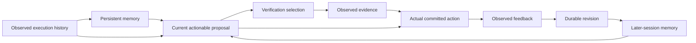

# TrustMem diagnostic benchmark: a cumulative research instrument

2026-11-13. Development design and implemented diagnostics, not a validated comprehensive benchmark.

The fixed research question is: **when a later task differs from earlier tasks, which past evidence still permits the current action, what verification is worth acquiring, and which durable revision improves subsequent decisions?** Single-agent sessions and asynchronous multi-agent handoffs are two schedules of this same evidence-to-action lifecycle. Concurrency is a stress factor; it is not a new research direction.

## What counts as a bottleneck

An opportunity need not be a universal failure of all memory algorithms. A special setting is legitimate when its constraints have a stated operational motivation, its ordinary baselines retain their capabilities, and improvement has a specified target. Register opportunities at the following evidence levels:

| Level | Meaning | What may be concluded |
|---|---|---|
| B0 | Motivated hypothesis, predicted optimization opportunity | Worth a bounded diagnostic; no observed failure asserted |
| B1 | Measured wrong action, unnecessary abstention, cost or recovery delay | A discrepancy exists in the declared workload |
| B2 | A component intervention changes the predicted outcome | Localized improvement or trade-off in this component; no global cause claim |
| B3 | Feasible same-access improvement beyond named strong baselines | A candidate method result under its declared cost regime |
| B4 | Frozen independent histories confirm the result | A scoped generalization result, with uncertainty |

`EXPLAINED` closes a particular need already met by an ordinary method. It does not close long-term memory research. `UNOBSERVABLE`, `UNSUPPORTED`, `NOT_RUN`, and a measured zero are different states. B0/B1 can justify exploration; they do not authorize claiming a novel method.

Specify the operational expectation before collecting a new batch: for example, do not pay twice for an unchanged exact cached observation; obey a current authoritative exact quote; retain unrelated valid knowledge after a revision; reduce cost at matched completion and error. An unattainable oracle upper bound is not evidence that missing information was cheaply recoverable.

## One causal chain and an intervention ladder

The diagram is a research model, not a demonstrated causal effect of every arrow. Diagnose a failure by holding the earlier stages fixed and substituting one component, in this order:

1. Native storage acknowledgement, fresh readback, retrieval and delivered payload. Diagnose interface errors before proposing learning.
2. Exact cache / full history / ordinary coverage summary with the same tools. Do not remove ordinary caching to create a need.
3. Fixed proposal, same-budget alternative verification allocation. Measure displaced evidence and all affected requests.
4. Fixed observations and output, ordinary authoritative binding / legal replay. Separate evidence acquisition from action conformance.
5. Fixed feedback, ordinary scoped reconstruction and durable update, followed by a real fresh-session decision.
6. Only then test a candidate computation against these controls and its closest published alternative.

These interventions are diagnostic controls; several cannot be implemented in an opaque native system. Missing visibility must remain explicit. A repair in one stage is not permission to pivot to a new topic. Update the existing mechanism card, its rival explanations and next discriminating prediction.

## Required diagnostic surface

| Stage | Observable records | Main measurements | Current implementation |
|---|---|---|---|
| Formation | Actual history, first writer response, saved object | Scope errors, lossy compression, writer cost | SAP saved logs; semantic independent labels missing |
| Persistence | Object ID, revision, verbatim body, fresh read | Committed/readable ratio, revision mismatch | SAP readback; SQLite/Markdown local baseline adapters |
| Retrieval | Native query, candidate IDs, delivered payload | Availability versus delivery, retrieval bytes/tokens | Delivered SAP payload; native ranked retrieval not yet run |
| Applicability | Task, source/version, quote context | Exact-match coverage; explicit binding mismatch if declared | SAP and EAD trace diagnostics |
| Verification | Proposed actions, chosen tool/object, cache before call | Repeated exact checks, missed proposal coverage, quote counts | SAP 40 quota opportunities; EAD1 controlled replacement |
| Action | Unaltered model response and actual tool effect | Correct/wrong/deferred/unfinished; known-evidence errors | SQL-backed SAP/EAD; ordinary binding replay |
| Repair | Revision input, submitted revision, fresh read | Repair precision, valid-content retention, edit/read cost | Earlier lifecycle assets; not a unified semantic scorer |
| Inheritance | New process/session, delivered revision, actual action | Benefit and persistence after repair | Existing runtime/M7 assets; not established by EAD1 |
| Async/agents | Readers/writers, branch identity, commit order, native version | Stale-read exposure and propagation; attributable business loss | Design only; no concurrency result claimed |

This is a coverage ledger, not a claim that every cell is implemented. Add difficulty along a declared axis: joint support order, source/version ambiguity, revision lag, or feedback sparsity. Include safe unchanged reuse and adequate-evidence controls at every difficulty. Preserve easy successes and all seeds. The existing 28/4 joint-coverage construction is an authored mathematical challenge, not evidence that agents naturally fail on it.

## Metrics and costs

For every ratio, publish numerator, eligible denominator, unit, scope and observability. Keep planned opportunities, successful API responses, actual submissions and independent history families separate. Publish order-level results and session-level tool choices. A correct unquoted prediction remains correct; unsupportedness requires an explicit evidence contract and a separate metric. A visible citation is not causal use.

Report correct completion, wrong submission, abstention and unfinished tasks together. For matched interventions also report target and non-target changes, and later-session effects when actually run. Pareto comparisons name their cost dimensions: equal calls and quotes do not imply equal tokens, dollars or latency. Source scans, backend caching, model calls/tokens, storage read/write, retrieval, verification, repair and total workload cost remain separate. Simulated quote quotas are experimental budgets, not measured industrial verification costs.

## Fair system adaptation

Declare versions and actual native capabilities first. Wrap native writer/retriever behavior rather than replacing every system with a common algorithm. Keep semantic extraction/consolidation enabled when it is part of the system, count its model costs, and record whether extra history was actually read. Fork only through a native snapshot or a recorded replay supported by the system. No silent emulation of unsupported update, delete, transaction or background-drain operations.

Implemented today: local SQLite and verbatim Markdown reference stores, a callable native-operation bridge, and read-only SAP diagnostics. This is **not** end-to-end adaptation of Mem0, Letta or LangMem. See [capabilities](ADAPTER_CAPABILITIES.md). The cross-system goal is a shared measurement contract, not a fictional promise that every internal field is visible in every system.

The SAP trace analyzer requires the parent workspace's frozen SAP original/continuation artifacts; these archives are not bundled into this repository. The instrument calibration and local adapter tests are self-contained. Aggregate diagnostics in `reports/diagnostics` are an evidence summary, not a standalone reproduction of the remote model calls.

## From diagnosis to a method

The [mechanism registry](MECHANISM_REGISTRY.md) tracks one research program. Each card must name evidence level, ordinary competitors, the first changed computation, equal-access requirements, rival predictions and a stopping/update rule. Test one cause-discriminating intervention before adding modules. A better scheduler plus a better writer is not automatically one new principle.

The most useful current working hypothesis is that **a memory-dependent verification policy must be evaluated by its effect on all imminent actions and subsequent evidence availability, rather than target correction alone**. EAD1 supports the importance of this diagnostic distinction in eight related authored states; it does not establish a new scheduler or long-term memory effect. The stronger candidate—memory-specific action disagreement identifies high-value verification beyond ordinary coverage and active selection—remains unconfirmed.

## Prior-work boundary

[AMV-Guard](https://arxiv.org/html/2610.31446v1) already studies action-conditioned, cost-aware verification and stopping. [ReScopeBench](https://arxiv.org/html/2611.05450v1) already measures experience lifecycles and tool allocation. We do not claim novelty for these broad concepts or their joint reporting. The proposed benchmark contribution must come from validated cause-discriminating tasks, reproducible diagnostic interventions and findings not already explained by ordinary controls. Current code is research infrastructure, not proof that this contribution has been achieved.

## Immediate run order

1. Complete EAD1 and the frozen ordinary binding controls; retain their adverse whole-batch result.
2. Validate the diagnostic instrument with known injected faults and no-fault controls; report this as engineering calibration.
3. Freeze one small full-session study of **actual precommit differences**, ordinary coverage-priority allocation and ordinary quote binding. Keep full history, exact cache and the same number of model calls. The design must distinguish memory-specific signal from ordinary uncertainty and output noise; do not start another paid batch until that protocol is concrete.
4. Only expand native systems and independent histories after a diagnostic prediction survives its ordinary controls. Capability integration and research evidence proceed in separate ledgers.
